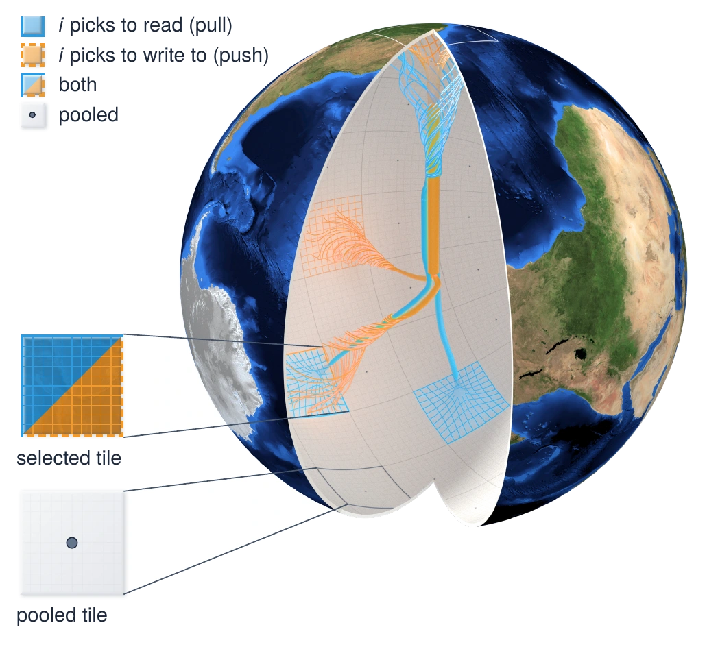
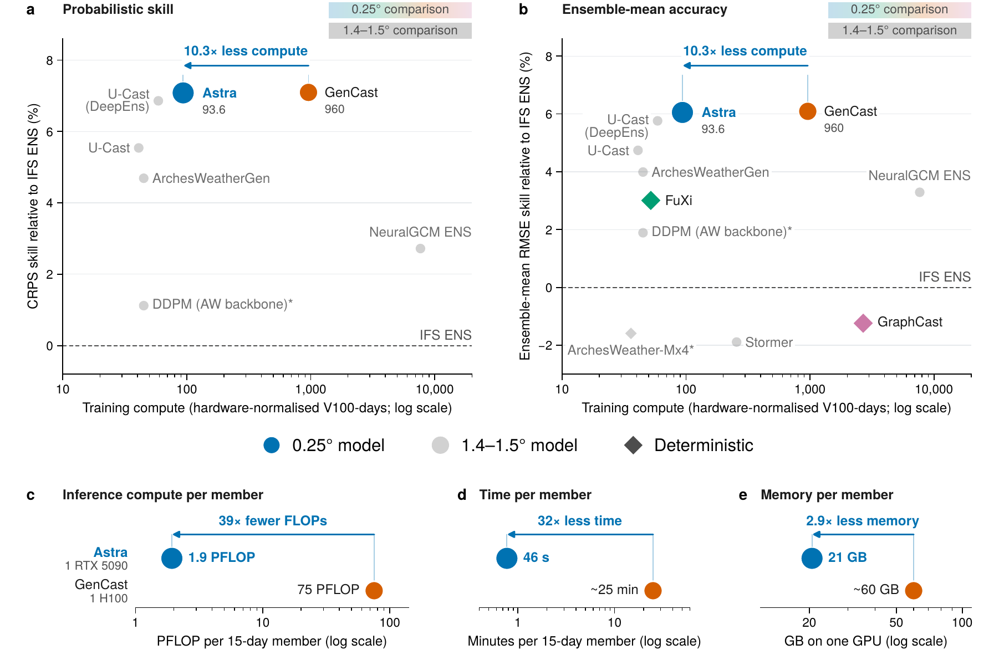
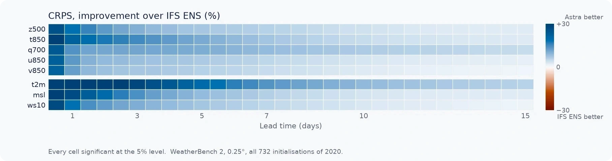
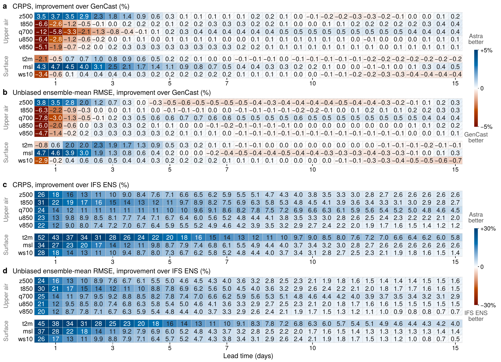
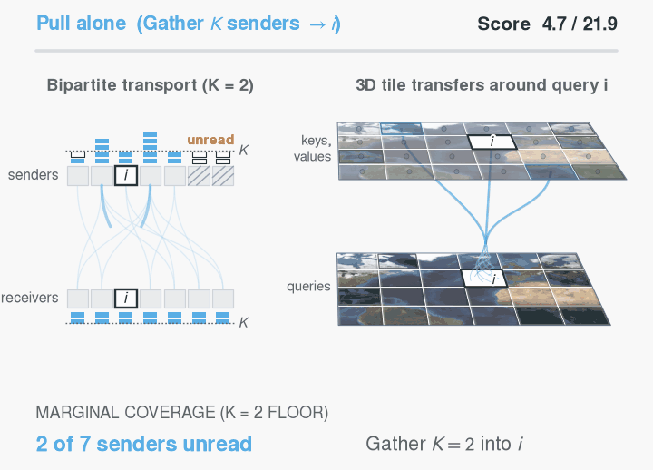
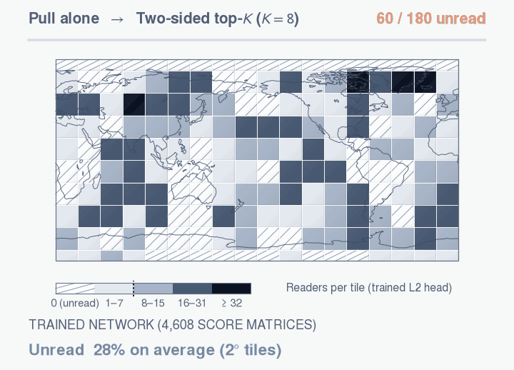
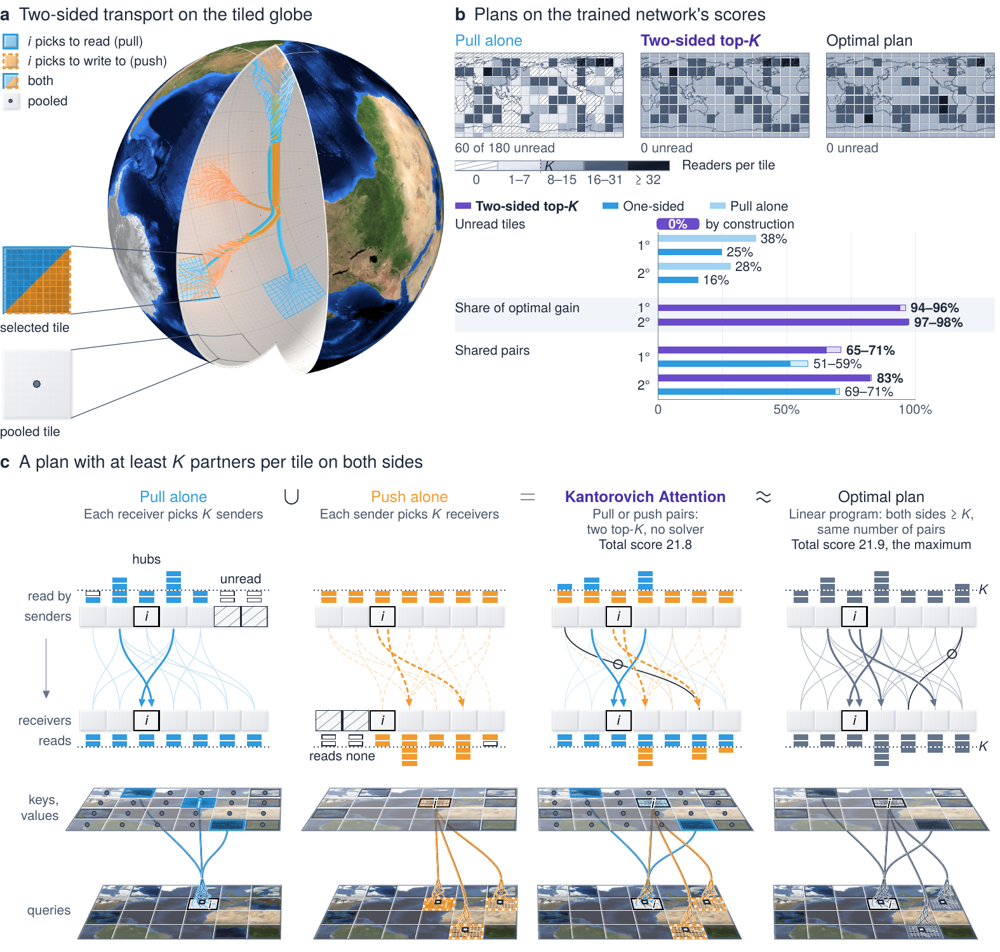

<p align="center">
  
</p>

<h1 align="center">Astra</h1>

<p align="center">
  <b>Efficient probabilistic weather forecasting at quarter-degree resolution<br>with two-sided transport attention</b>
</p>

<p align="center">
  Junu Choi · Youngjoon Hong<br>
  Seoul National University
</p>

<p align="center">
  <a href="https://arxiv.org/abs/2610.35545"></a>
  <a href="https://arxiv.org/pdf/2610.35545"></a>
  <a href="LICENSE"></a>
  
  
</p>

Astra forecasts on the 0.25° grid with Kantorovich Attention, in which each region chooses both where it reads from and
where it writes to, so every region sends and receives information at token resolution. Trained on one node of eight
GPUs, it matches GenCast's skill with 9.8% of its hardware-normalised training compute.

This repository holds the paper's 0.25° evaluation: the WeatherBench 2 scorer, the scorecards and significance tests,
and the per-initialisation scores from which the paper's 0.25° score-based numbers are recomputed in under a minute on
a single CPU core.

**Contents:** [Highlights](#highlights) · [Results](#results) · [Kantorovich Attention](#kantorovich-attention) ·
[Getting started](#getting-started) · [Guide](#guide) · [Metrics](#metrics) · [Citation](#citation)

## Highlights

- **GenCast's skill for a tenth of the training compute.** Astra matches GenCast's CRPS averaged over five upper-air
  targets and days 1–10 with 9.8% of its hardware-normalised training compute.
- **Lower errors than the ECMWF ensemble on every target.** Verified against ERA5, its CRPS and ensemble-mean
  root-mean-square error are lower than those of IFS ENS on all 600 variable, level and lead-time combinations, and
  its CRPS is lower than GenCast's on 73.5% of them.
- **Fast to run.** A 15-day member needs 39 times fewer floating-point operations than GenCast's GPU implementation,
  and 50 members take under 40 min on one consumer GPU, within 21 GB.
- **Two-sided transport attention.** No tile is left unread, and the two-sided top-*K* solution reaches 94–98% of the
  optimal plan's gain over random pairs, without a solver.
- **Self-featurised CRPS.** Training also scores forecasts in the model's own multiscale features.

## Results

<p align="center"></p>

<p align="center"><b>Fig. 1 | Astra matches GenCast's skill with 9.8% of its hardware-normalised training compute and
39 times fewer inference FLOPs per member than its released GPU implementation.</b></p>

|                                                       | Astra             | GenCast            |
| :---------------------------------------------------- | ----------------: | -----------------: |
| Training compute (hardware-normalised V100-days)      | 93.6              | 960                |
| CRPS skill relative to IFS ENS ¹                      | 7.1%              | 7.1%               |
| Ensemble-mean RMSE skill relative to IFS ENS ¹        | 6.1%              | 6.1%               |
| Inference compute per 15-day member                   | 1.9 PFLOP         | 75 PFLOP           |
| Time per 15-day member                                | 46 s (1 RTX 5090) | ~25 min (1 H100)   |
| Memory per member                                     | 21 GB             | ~60 GB             |

¹ 100 (1 − S / S<sub>IFS ENS</sub>), averaged over daily lead times of 1–10 days and z500, q700, t850, u850 and v850
(RMSE without q700; unbiased ensemble-mean RMSE). As in the GenCast evaluation, IFS ENS is verified against its own
analysis. Both models are scored at 0.25° against ERA5 on the 732 initialisations of 2020.

<p align="center"></p>

<p align="center">CRPS improvement over the ECMWF ensemble (IFS ENS) in WeatherBench 2 at 0.25°, verified against ERA5:
lower on every variable and lead time.</p>

<details>
<summary><b>Full scorecards against GenCast and IFS ENS (Fig. 4)</b></summary>
<br>
<p align="center"></p>

**Fig. 4 | Astra has a significantly lower CRPS than IFS ENS for every variable and lead time and, from day 3, a lower
CRPS than GenCast on 153 of the 200 combinations; every significant difference in GenCast's favour lies within the
first 60 h.** Its counts are recomputed by `eval025/scripts/reproduce_paper_025.py`.
</details>

## Kantorovich Attention

Each region (tile) of the grid chooses both the tiles it reads from (pull) and the tiles it writes to (push). Together
the two choices form a transport plan in which every tile sends and receives at token resolution.

<table>
  <tr>
    <td width="50%"></td>
    <td width="50%"></td>
  </tr>
  <tr>
    <td>On a toy score matrix (7 tiles, <i>K</i> = 2), pull gathers <i>K</i> senders into query tile <i>i</i> and push
    scatters <i>i</i> to <i>K</i> receivers. Their union satisfies both marginal floors (≥ <i>K</i>) and reaches a total
    score of 21.8 against 21.9 for the optimal plan.</td>
    <td>In the 4,608 plans of the trained network (24 initialisations, all blocks and heads), pull alone leaves on
    average 28–38% of the tiles unread. Two-sided top-<i>K</i> leaves none unread by construction and reaches 94–98%
    of the optimal plan's gain.</td>
  </tr>
</table>

<details>
<summary><b>Kantorovich Attention in the trained network (Fig. 2)</b></summary>
<br>
<p align="center"></p>

**Fig. 2 | Kantorovich Attention routes from both sides: no tile is left unread, and the two-sided top-*K* solution on
one branch's scores reaches 94–98% of the optimal plan's gain over random pairs.** Earth imagery, NASA Blue Marble
Next Generation.
</details>

## Getting started

Everything runs on a CPU with Python 3.12; no GPU is needed.

```bash
git clone https://github.com/Junu-Choi/astra-wx.git
cd astra-wx/eval025
python3.12 -m venv .venv && source .venv/bin/activate
pip install -r requirements.txt
```

Check the installation by reproducing the paper's numbers and running the tests (each well under a minute):

```bash
python scripts/reproduce_paper_025.py   # exit status 0 when every number matches
python -m pytest -q tests
```

```text
eval025/
├── astra_eval025/   scorer, scorecard and significance tests, figure inputs, paper-number checks
├── scripts/         reproduce_paper_025.py, make_scorecard.py, score_forecasts.py, fetch_wb2_results.sh
├── data/            Astra and IFS ENS scores, WeatherBench 2 result files, reference outputs
└── tests/
```

## Guide

All commands run from `eval025/`.

### 1. Reproduce the paper's numbers

```bash
python scripts/reproduce_paper_025.py [--json numbers.json]
```

After a check of the stored IFS ENS scores, each line is one number of the paper, its value in the paper and the
value recomputed from `data/`:

```text
IFS ENS per-initialisation scores reproduce the published file to 7.86e-08
OK   CRPS lower than GenCast, 20 targets x 30 leads   paper  441/600 (73.5%)   reproduced 441/600 (73.5%)
OK   CRPS lower than GenCast from day 3                paper    406/500 (81%)   reproduced 406/500 (81%)
OK   CRPS lower than IFS ENS (vs ERA5) on all 600      paper          600/600   reproduced 600/600
...
```

`--json` writes the same rows as a list of `{id, statement, paper, reproduced, match}`.

### 2. Build a scorecard with significance tests

```bash
python scripts/make_scorecard.py data/astra_2020_025_per_init_scores.npz --wb2-dir data/wb2 \
    --ens-states data/ifs_ens_2020_24h_per_init_scores.npz --out out/
```

This compares the stored Astra scores with the WeatherBench 2 result files of GenCast and IFS ENS and writes, in under
a minute,

* `out/scorecard.json`: `cells`, one entry per reference, metric, variable and lead time with both scores and, for CRPS
  and unbiased ensemble-mean RMSE, their ratio, the change in per cent, the 95% bootstrap interval and the verdict; `summary`, the wins, losses and significant wins
  and losses per reference, metric and lead time; `meta`, the settings;
* `out/astra_vs_era5_1440x721_2020.nc`: the scores in the layout of the WeatherBench 2 result files.

```python
import json

card = json.load(open("out/scorecard.json"))
cell = next(c for c in card["cells"]
            if (c["ref"], c["metric"], c["var"], c["lead_h"]) == ("ens", "crps", "t2m", 120))
print(cell["pct"], cell["ci_widened"], cell["significant"])   # -19.8 [0.796, 0.809] True (rounded)
```

### 3. Score your own forecast

Install the extra packages for reading forecast stores (zarr, and gcsfs with aiohttp for remote stores):

```bash
pip install -r requirements-forecast.txt
```

The forecast is a zarr store in the WeatherBench 2 layout on the 0.25° grid (721 × 1440, poles included; latitude in
either order):

* dimensions `time` (initialisation), an ensemble dimension, `prediction_timedelta`, `level`, `latitude`, `longitude`
  (`lat` and `lon` are accepted);
* `geopotential`, `temperature`, `specific_humidity`, `u_component_of_wind` and `v_component_of_wind` at 500, 700 and
  850 hPa, and `2m_temperature`, `mean_sea_level_pressure`, `10m_u_component_of_wind` and `10m_v_component_of_wind`;
* `total_precipitation_6hr` every 6 h for the 24 h precipitation row (or pass `--no-tp24h`).

Wind speeds and 24 h precipitation are derived from these. Score the store against ERA5 from the public WeatherBench 2
bucket (no credentials needed), then build its scorecard:

```bash
python scripts/score_forecasts.py --forecast my_forecast.zarr \
    --era5 https://storage.googleapis.com/weatherbench2/datasets/era5/1959-2023_01_10-wb13-6h-1440x721_with_derived_variables.zarr \
    --out my_scores.npz --ens-dim number
python scripts/make_scorecard.py my_scores.npz --wb2-dir data/wb2 \
    --ens-states data/ifs_ens_2020_24h_per_init_scores.npz --label MyModel --out my_card/
```

Options of `score_forecasts.py`:

* `--inits`: `2020` (default) for the 732 initialisations of 2020 at 00 and 12 UTC, or a list such as
  `2020-01-01T00,2020-01-01T12`;
* `--leads`: lead times in hours, such as `24,120,240` (default: 12 to 360 every 12 h);
* `--ens-dim`: name of the ensemble dimension (default `number`);
* `--members N`: score only the first N members;
* `--group`: members per float32 scoring block, a divisor of the number of members (default 2).

To try a few initialisations or lead times first, pass `--inits` and `--leads`, and add `--allow-partial` to
`make_scorecard.py`.

### 4. Download the WeatherBench 2 result files again

```bash
bash scripts/fetch_wb2_results.sh
```

The script downloads the result files in `data/wb2/` (about 13 MB) from WeatherBench 2, checks their sha256 against those used
for the paper and only then replaces the local copies.

## Metrics

The metrics follow WeatherBench 2, area-weighted with its cell-area latitude weights and averaged over initialisations
before square roots and ratios are taken:

* **CRPS**: the fair (unbiased) ensemble CRPS.
* **Unbiased ensemble-mean RMSE**: `sqrt(mean_i mse_i − mean_i sp2_i / M)`, with `mse` the squared error of the
  ensemble mean and `sp2` the ensemble variance (M − 1 in the denominator).
* **Spread–skill ratio**: `sqrt(mean_i sp2_i)` over the unbiased ensemble-mean RMSE.
* **Significance**: a circular block bootstrap over the time-ordered initialisations (blocks of 14, 10,000 resamples,
  seed 20201231); paired with IFS ENS where its per-initialisation scores exist (24 h), otherwise against the published
  reference value with the interval widened by κ.

[`eval025/README.md`](eval025/README.md) gives the definitions in full and the contents of `data/`.

## Citation

```bibtex
@misc{choi2026astra,
  title         = {Efficient probabilistic weather forecasting at quarter-degree resolution with two-sided transport attention},
  author        = {Choi, Junu and Hong, Youngjoon},
  year          = {2026},
  eprint        = {2610.35545},
  archivePrefix = {arXiv},
  url           = {https://arxiv.org/abs/2610.35545}
}
```

## Licence and acknowledgements

The code is under the Apache License 2.0 ([`LICENSE`](LICENSE)). The figures in `docs/figures/` are from or adapted from the
paper, © 2026 the authors; their Earth imagery is NASA Blue Marble Next Generation.

The evaluation uses WeatherBench 2 (Rasp et al., J. Adv. Model. Earth Syst. 16, e2023MS004019, 2024): its ERA5 store,
its result files and its metric definitions. ERA5 and IFS ENS are produced by ECMWF, ERA5 within the Copernicus Climate
Change Service.
